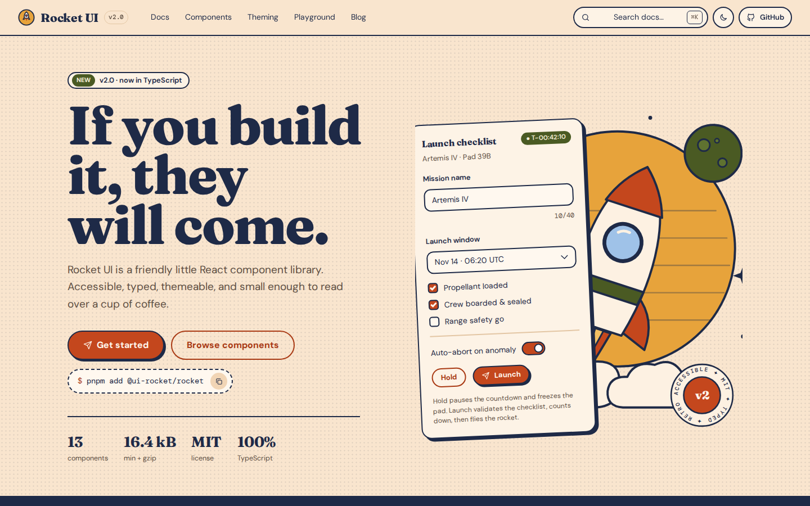
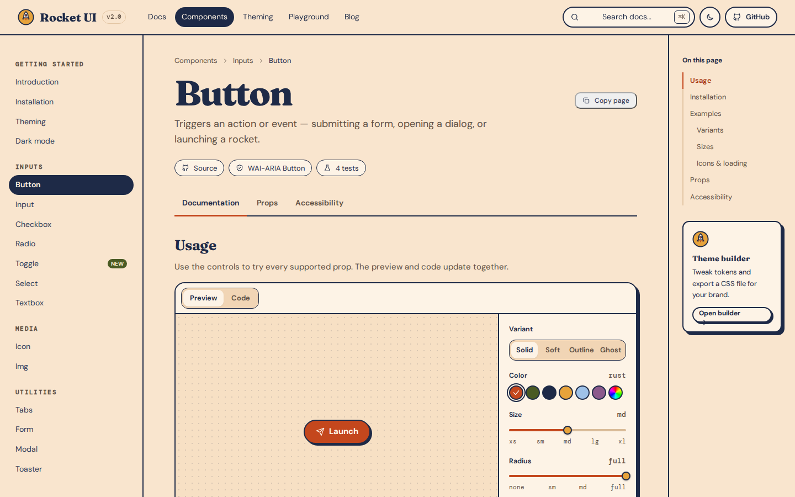

# Rocket UI

A React component library with a Retro Launch design system, written in TypeScript.

Built by Yehuda Menahem · [LinkedIn](https://www.linkedin.com/in/yehuda-menahem-49022330/)

**Live site:** [https://rocket-ui-tau.vercel.app](https://rocket-ui-tau.vercel.app)





## What it is

Rocket UI is a personal portfolio project: a small, typed React component library and a showcase site that documents each component with live playgrounds, theming, and dark mode.

It is useful as a reference for how a design-system-style library can be structured in a pnpm monorepo with strict TypeScript, Vite, and automated checks. It is **not published to npm** yet — install and use it from this repository (workspace package `@ui-rocket/rocket`).

## What works today

- **13 components** exported from `packages/rocket`: Button, Checkbox, Form, Icon, Img, InputField, Modal, RadioButton, SelectField, Tabs, Textbox, Toaster, ToggleButton
- Showcase site with per-component docs pages, interactive playgrounds, theming, and dark mode
- Continuous integration with GitHub Actions (typecheck, lint, test, build)
- Production deploy on Vercel at the live URL above

## Tech stack

- React 19
- TypeScript (strict)
- Vite
- pnpm workspaces
- React Router 7
- Sass
- Vitest
- ESLint
- Prettier
- GitHub Actions
- Vercel

AI coding agents, working under AGENTS.md

## Run locally

**Prerequisites:** Node.js >= 18, pnpm >= 8

```bash
pnpm install
pnpm --filter @ui-rocket/rocket build   # build the library once
pnpm dev                                # showcase site at http://localhost:3000
```

Useful root scripts (from `package.json`):

```bash
pnpm start          # same as pnpm dev
pnpm build          # build all workspace packages
pnpm typecheck      # TypeScript across the monorepo
pnpm lint           # ESLint
pnpm test           # Vitest
pnpm format         # Prettier write
pnpm format:check   # Prettier check
```

Per-package:

```bash
pnpm --filter @ui-rocket/rocket build
pnpm --filter @ui-rocket/rocket test
pnpm --filter @ui-rocket/site dev
```

## License

MIT
